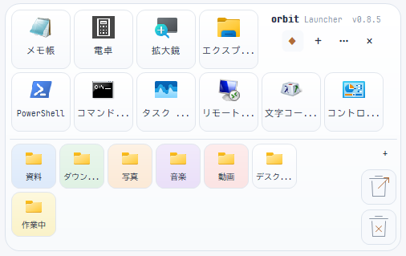
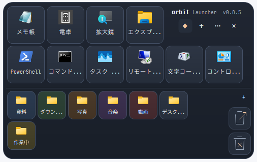

# Orbit Launcher

## English

Orbit is a Windows launcher written in Rust with a native Win32 interface.
Draw a circle with your mouse or press a hotkey to bring up your apps and folders.
Apps are organized into pages; shared buttons stay available below them.

- Requires Windows 11 x64.
- Download `orbit-launcher-<version>-windows-x64.zip` from [Releases](https://github.com/azukihoney/orbit-launcher/releases).
- Extract **all** files into a writable personal folder, then run `orbit-launcher.exe` or `start.cmd`.
- The executable is unsigned; Windows SmartScreen or security software may show a warning.
- By default, draw 1.5 counterclockwise turns, or press `Ctrl+Alt+Space`.
- Settings are stored beside the executable in `data/config.json`.
- Orbit has no built-in internet communication or automatic updates.
- To build from source, install Rust stable (MSVC), MSVC build tools and the Windows SDK, then run `cargo build --locked --release`.
- Licensed under [MIT](LICENSE). See [third-party notices](THIRD_PARTY_NOTICES.md) for other components.

## Orbit について

Orbit は、マウスで円を描くかキーを押して呼び出す Windows 用ランチャーです。上段にはページごとのアプリ、下段には全ページ共通のフォルダなどを登録できます。Rust / Win32 製で、ライト・ダークのテーマを選べます。現在のバージョンは **0.8.7** です。

ライトテーマ：



ダークテーマ：



## 動作環境と入れ方

**Windows 11 x64** 向けです。配布 ZIP で使う場合、開発ツールの導入は不要です。

1. [Releases](https://github.com/azukihoney/orbit-launcher/releases) から `orbit-launcher-<版>-windows-x64.zip` をダウンロードします。
2. ZIP を右クリックして「すべて展開」を選び、書き込み可能な個人用フォルダへ展開します。ZIP の中から直接起動しないでください。
3. 展開先の `orbit-launcher.exe` または `start.cmd` を実行します。

実行ファイルには署名がありません。ダウンロードした ZIP から起動すると、SmartScreen の「Windows によって PC が保護されました」や「セキュリティの警告」が出ることがあります。入手元を確認したうえで、SmartScreen では「詳細情報」→「実行」で進めます。セキュリティソフトが警告することもあります。

設定は exe と同じ場所の `data/config.json` に保存します。別の端末へ移すときは、登録先のパスやフォントの導入状況を移動先に合わせてください。

## 基本の使い方

### 呼び出す・固定する・隠す・終了する

- 既定では、マウスで**反時計回りに円を1.5回**描くと表示します。制限時間の既定値は1秒です。描きにくければ、設定で回転方向（時計回り・両方向）、回数、制限時間、半径を変えられます。
- `Ctrl+Alt+Space` でも表示します。このキーの登録に失敗した場合だけ、代わりに `Ctrl+Alt+Shift+Space` を登録します。両方のキーが使用中なら、円描画やトレイアイコンから呼び出してください。
- 通知領域（トレイ）の Orbit アイコンをクリックしても表示します。
- 右上の **◇** で表示を固定・解除します。固定中は、外側のクリックやマウスの退出、登録の実行によって隠れません。
- **×** または `Esc` は画面を隠します。常駐は続きます。完全に終了するには、トレイアイコンの右クリックメニューから「終了」を選びます。右上の **⋯** にも「終了」があります。
- 固定していないときは、枠の外でクリックを離すと隠れます。左・右・中ボタンなど全マウスボタンが対象ですが、短すぎるクリックを取りこぼして閉じない場合があります。
- 「マウスが外へ出たら隠す」も既定で有効です。無効にしても、枠外クリックによる非表示は有効です。

呼び出した画面は最前面に表示され、表示中は最前面を維持します。設定・編集画面はメイン画面より前に表示します。

### 登録を追加・編集する

右上の **⋯** →「アプリを追加…」または「共通ボタンを追加…」を選びます。表示名・対象・引数・作業フォルダ・種類を指定できます。表示名と対象は必須です。種類は「アプリ・bat・cmd・ファイル」または「フォルダ」から選びます。

エクスプローラーからファイル・ショートカット・フォルダを Orbit の上段または下段へドラッグしても登録できます。空きマスを狙うとそこへ配置します。配置できる場所が足りない場合は、設定で行・列を増やしてください。

登録ボタンを右クリックすると、次の操作ができます。

| 項目 | 操作 |
| --- | --- |
| ボタンを追加… | その領域に登録を追加 |
| 編集… | 表示名・対象・引数などを変更 |
| ファイルの場所を開く | 登録先の場所を開く。対象によっては選べません |
| 上下段へ移動 | 現在のページの上段と共通の下段の間で移動 |
| 登録を削除… | 登録だけを削除。元のファイルは削除しません |
| 色（下段のみ） | 赤・橙・黄・緑・青・紫の6色。「なし」で解除 |

同じ段の中で、ボタンを空きマスへドラッグすると移動、別のボタンへドラッグすると入れ替えになります。上下段をまたぐ移動は右クリックのメニューを使います。

### ページと画面の操作

- ページが2つ以上あるときだけ、画面の上にページ名のタブが表示されます。タブをクリックすると上段の登録が切り替わります。下段は全ページで共通です。
- **⋯** からページの追加・名前変更ができます。削除できるのは空のページだけで、最後の1ページは削除できません。
- タイトル・水平線・余白・空きマスをドラッグして画面を移動できます。
- 行が画面に収まらないときは、上段・下段それぞれの領域でマウスホイールを使ってください。
- ゴミ箱を開く・空にするボタンもあります。空にするときは Windows 標準の確認画面が出ます。取り消しても自動で再試行しません。

## 設定

**⋯** →「ジェスチャー・表示設定…」で変更します。「はい／いいえ」の項目は有効・無効の切り替えです。

| 項目 | 選択肢・範囲 | 既定値 |
| --- | --- | --- |
| 表示言語 | 日本語・English | 日本語 |
| フォント | 導入済みフォント名。変更時は UTF-16 で31要素以内、空白だけは不可 | UDEV Gothic |
| アプリをアイコンだけで表示 | はい・いいえ | いいえ |
| アプリ文字サイズ | 8〜16 px | 11 px |
| フォルダ文字サイズ | 8〜16 px | 10 px |
| UIの大きさ | 自動（ディスプレイに合わせる）・75〜200% | 自動 |
| テーマ | ライト・ダーク | ライト |
| アプリの行数 | 1〜16 | 2 |
| アプリの列数 | 2〜32 | 6 |
| フォルダの行数 | 1〜16 | 2 |
| フォルダの列数 | 1〜32 | 6 |
| 円を描く回数 | 1.5〜4回 | 1.5回 |
| 制限時間 | 0.3〜6秒 | 1秒 |
| 最小半径 | 5〜400 画面px | 12 画面px |
| 最大半径 | 30〜1500 画面px | 800 画面px |
| 回転方向 | 反時計回りだけ・時計回りだけ・両方向 | 反時計回りだけ |
| 円描画を有効にする | はい・いいえ | はい |
| マウスが外へ出たら隠す | はい・いいえ | はい |
| 全画面アプリ中は停止 | はい・いいえ（円描画による呼び出しを停止） | はい |

最小半径は最大半径より小さくしてください。「UIの大きさ」で 75〜200% を選ぶと、ディスプレイの拡大率に関係なくその大きさで表示します。画面の幅に収まらないときは、収まる大きさまで自動で小さくします。UDEV Gothic は同梱していません。未導入なら代替フォントで表示します。

上段の最初の行の右端2マスはゴミ箱用です。行・列を減らして既存の配置が収まらなくなる場合は保存できないので、先にボタンを移動してください。

### 設定ファイルとバックアップ

通常は `data/config.json` を使います。**⋯** →「設定フォルダを開く」で保存先を開けます。既存の設定を保存し直すと、直前の内容を `config.json.bak` に残します。

手動で編集・復元するときは Orbit を終了してから作業してください。起動中に外部から設定が変わると、上書きを避けるため保存を拒否します。その場合は再起動して外部の変更を読み込みます。不正な JSON は上書きせずエラーにします。

### コマンドライン引数

| 引数 | 動作 |
| --- | --- |
| `--config <パス>` | 設定ファイルを指定。相対パスは起動時の作業フォルダが基準 |
| `--hidden` | メイン画面を隠した状態で起動 |
| `--no-gesture` | 起動時の円描画による呼び出しを無効化。メニューから再有効化できます |
| `--preview <PNGパス>` | 描画結果を PNG に保存して終了。保存前に画面の表示・最前面化が発生します |

### Windows 起動時に常駐させる

自動スタートアップ登録は行いません。必要なら次の手順で登録できます。

1. `orbit-launcher.exe` のショートカットを作ります。
2. ショートカットのプロパティの「リンク先」で、exe のパスの後ろに半角スペースと `--hidden` を付けます。パスの引用符がある場合は、その閉じ引用符の後ろに付けます。
3. `Win+R` で `shell:startup` を開き、ショートカットを置きます。

`start.cmd` は引数を転送しないため、隠して起動するショートカットは exe を直接指定してください。

## プライバシーと通信

Orbit 本体には、インターネット通信・自動更新の機能はありません。登録したアプリやリンクを開いた後の通信は、その起動先の動作によります。

**⋯** →「円描画の診断ログ…」で確認に同意した場合だけ、ランチャーを隠して約20秒間記録します。保存内容はマウスの相対座標、経過時間、認識状態・認識結果、設定値、集計値です。キー入力・画面・絶対座標は保存しません。ログは設定フォルダ内の `captures/gesture-<時刻>.json` に保存し、自動送信しません。

## 既知の制限

- 設定画面を開いたまま画面の拡大率を変えると、画面の中身が元の大きさのまま崩れる場合があります。設定画面の右上の × で閉じ、開き直してください。× はキャンセルと同じで、その回の変更は保存しません。
- 拡大率175%以上の表示は未確認です。
- タッチ操作・読み上げ・ハイコントラストでの利用は未確認です。
- ショートカットのアイコン指定先やリンク先からアイコンを取得できない場合は、ショートカット自体のアイコンへ戻ります。矢印付きになる場合があります。
- 枠外の短すぎるクリックは取りこぼして閉じない場合があります。
- ほかの円ジェスチャー型ランチャーと同時に有効にすると、両方が反応する場合があります。

## ソースからビルドする

Windows 上で、Rust stable の MSVC ツールチェーン（`x86_64-pc-windows-msvc`）、MSVC の C++ ビルドツール、Windows SDK を用意してください。MSVC と SDK は Windows 用 exe のリンクに使います。以下はリポジトリのルートで実行します。

```powershell
cargo build --locked --release
```

生成先は `target/release/orbit-launcher.exe` です。ソースのルートにある `start.cmd` を使うには、生成した exe をルートへコピーする必要があります。配布用の手順は下記を使ってください。

### テストとコードチェック

```powershell
cargo test --locked
cargo clippy --locked --all-targets -- -D warnings
cargo fmt --check
```

Win32 の画面操作を確認する道具には **Python 3.11以降**（標準ライブラリのみ）が必要です。通常版をビルドした後、次のように実行できます。

```powershell
py -3 -B tools/native_smoke.py --exe target/release/orbit-launcher.exe --output _checks/native-smoke
py -3 -B tools/review_regression.py --exe target/release/orbit-launcher.exe --output _checks/regression/results.json
```

`native_smoke.py` は設定・編集・ページ・ドラッグ登録などの操作と描画を確認します。`review_regression.py` はダイアログや診断完了時などの処理を別プロセスごとに確認し、各ケースの結果を保存します。どちらも一時設定と検証用の登録を使い、本物のカーソルを動かしたり、利用者の登録を編集・実行したり、実際にゴミ箱を空にしたりしません。画面操作を伴うため、Windows にログインしたデスクトップで実行してください。

`review-test` feature は検証専用で、配布しないでください。上の通常版向けコマンドでは不要です。`review_regression.py` は通常版では代替処理専用のケースを除外します。

### 配布 ZIP を作る

Python 3.11以降で、次の順に実行します。

```powershell
py -3 -B tools/build_release.py
py -3 -B tools/package.py
```

`build_release.py` はビルドした PC のローカルパスが exe に残らないようにパスを置き換えてリリースビルドし、ルートへ exe をコピーします。`package.py` は検証用ビルドやローカルパスが含まれる exe を拒否し、ルートの exe とビルド結果のハッシュ一致も確認します。

出力は `dist/orbit-launcher-<版>-windows-x64.zip` と `dist/SHA256SUMS.txt` です。ZIP には exe・`start.cmd`・`README.txt`・`LICENSE.txt`・第三者ライセンスを収め、利用者の設定は含めません。

## ライセンス

Orbit 本体は [MIT ライセンス](LICENSE)です。第三者の表記・ライセンスは [THIRD_PARTY_NOTICES.md](THIRD_PARTY_NOTICES.md)、[LICENSES.md](LICENSES.md)、[licenses/](licenses/) を参照してください。
